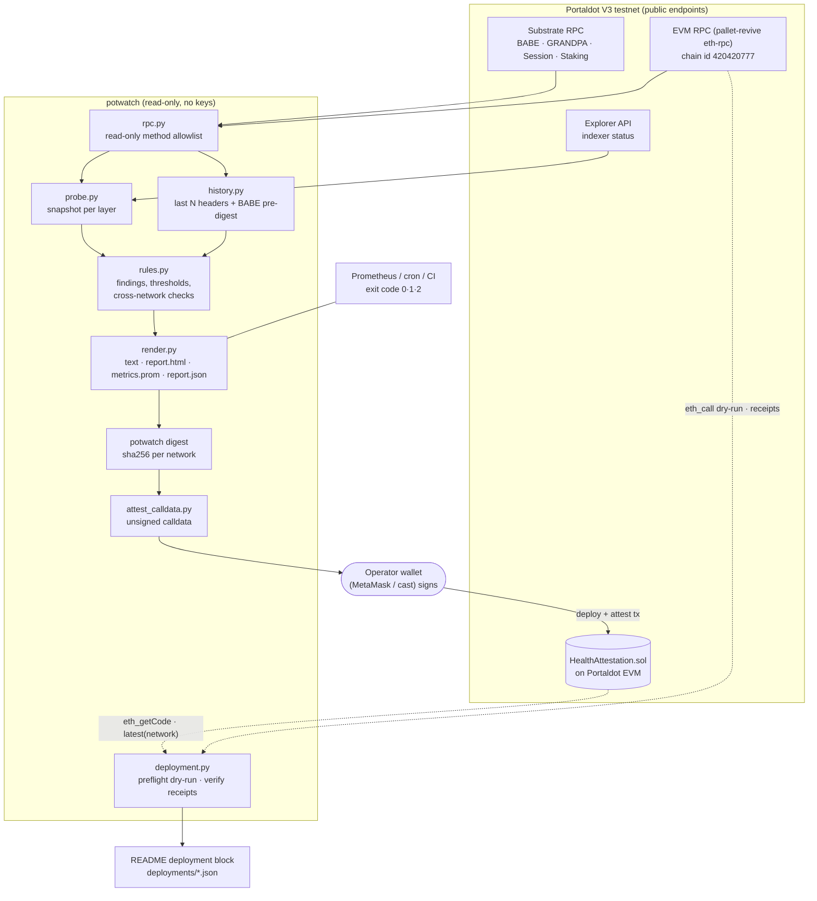
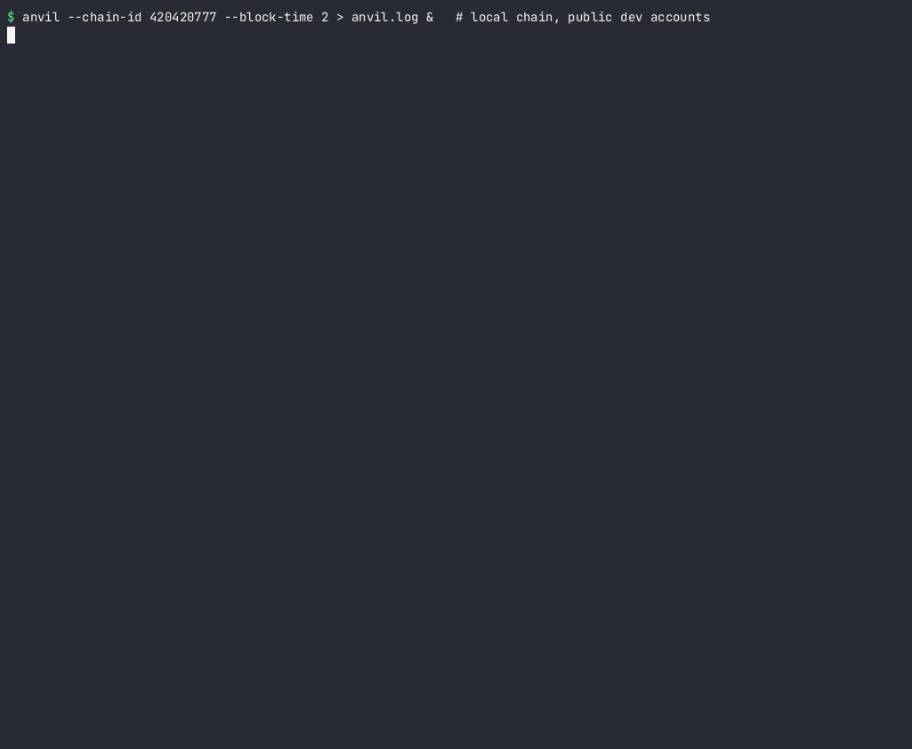

# potwatch: health checks for Portaldot V3 networks

**Track:** Node Operations & Tooling (Portaldot Hacker House 2026)

potwatch is a read-only health checker for Portaldot V3. It connects to the public Substrate RPC, the EVM RPC and the explorer API, decodes on-chain state (BABE slots, GRANDPA rounds, session validators), and tells an operator in plain language what is wrong and what to check next. Its verdicts can be published on the Portaldot EVM as tamper-evident attestations through a small contract (`HealthAttestation`).

It needs no keys to run. All RPC calls go through an allowlist of read-only methods (`potwatch/rpc.py`).

## Status

| | |
|---|---|
| Hacker House period | Oct 14 – Nov 6, 2026 (all code in this repo was written in this period) |
| Health checker (`potwatch check` / `watch` / `digest`) | **done**, runs against the live public endpoints |
| Rule engine + offline tests on captured V3 snapshots | **done** |
| `HealthAttestation` contract (build + keyless EVM test) | **done** |
| Deployment dry-run on the V3 testnet (`scripts/deployment.py preflight`) | **done**: the testnet node returns exactly the expected runtime code for the constructor |
| Deploy + first `attest` tx on a **local** chain (anvil, chain id 420420777) | **done**, reproducible with one script: see [Local deployment demo](#local-deployment-demo) |
| Deployment on the public V3 testnet | **outstanding**: needs tPOT, which is only handed out through a manual faucet request in Portaldot's Discord; see [Testnet deployment](#testnet-deployment) |
| Terminal demo of the local deployment | **done**: [`demo/local-demo.cast`](demo/local-demo.cast) (asciinema), [`.gif`](demo/local-demo.gif), [`.mp4`](demo/local-demo.mp4) |
| Demo video (≤ 3 min) | **outstanding**: script in [`docs/demo-script.md`](docs/demo-script.md) |

### Outstanding items / roadmap

- Deploy `HealthAttestation` on the public V3 testnet and publish the first attestation there (steps below; the same flow already runs end to end on a local chain).
- Record and link the demo video.
- Scheduled attestations: a cron recipe that attests every N minutes from a dedicated reporter key.
- Divergence check between an operator's own validator RPC and the public RPC (same height, same finalized hash).
- Alert sinks (webhook, Discord) on state changes from `potwatch watch`.
- A small read-only web page that lists attestations from the contract and re-verifies them against published reports.

## Why

Portaldot V3 runs a Substrate chain (BABE + GRANDPA) with an EVM on top. When something breaks, the symptom a dApp developer sees ("my tx never confirms") is several layers away from the cause (a node with 0 peers, a GRANDPA voter offline, an explorer that stopped indexing). potwatch checks every layer in one command and maps the result to a short list of findings.

### What it found on its first real run (2026-10-28, 23:56 UTC)

| Network | Verdict | Findings |
|---|---|---|
| `PortaldotV3 Test` (test-node-v3) | **CRIT** | best block #232115 is 11.2 h old (last block 12:45:54 UTC); RPC node and EVM RPC node have 0 peers; only 2 validators, so GRANDPA tolerates 0 faults |
| `PortaldotV3 Live` (live-v3-node) | **WARN** | 1 peer; only 2 validators |
| both | **WARN** | the same 2 session validator accounts, 1 BABE key and 1 GRANDPA key appear on both networks |

The full output is in [`examples/2026-10-29/`](examples/2026-10-29/): `report.json`, a self-contained `report.html` with block-time charts, and `metrics.prom` for Prometheus. In the 120 blocks before the testnet stalled, block time was a steady 6.0 s and both authorities authored blocks (58 / 62). In other words, production stopped all at once, with no gradual degradation beforehand. That points to a network or host event rather than a slow validator.

**Follow-up (2026-10-29):** the testnet resumed at 02:09:54 UTC with block #232116 after a 13 h 24 min halt, on the same chain (no reset). At 08:32 UTC potwatch reported it as WARN: producing blocks every 6.0 s (#235881, finality lag 2), still with 1 peer and 2 validators.

> These are observations from public endpoints at one point in time, not a security audit. Key reuse across networks may be intentional for a test deployment. potwatch flags it because it couples the failure domains of the two networks.

## Architecture



Rendered: [`docs/architecture.svg`](docs/architecture.svg) · [`docs/architecture.png`](docs/architecture.png). Data flow, safety model and GRANDPA fault-tolerance notes: [`docs/architecture.md`](docs/architecture.md).

## Checks

| Code | Severity | What it means |
|---|---|---|
| `RPC_DOWN` / `WRONG_CHAIN` | crit | endpoint unreachable, or serving a different chain than expected |
| `HEAD_STALL` / `HEAD_SLOW` | crit / warn | best block older than 10x / 3x the observed block time |
| `RPC_ISOLATED` / `LOW_PEERS` | crit / warn | RPC node has 0 / fewer than 2 peers |
| `FINALITY_STALL` / `FINALITY_LAG` | crit / warn | best minus finalized is at least 50 / at least 10 blocks |
| `GRANDPA_MISSING_VOTES` | warn / crit | finality is lagging and named voters are missing from the current round |
| `GRANDPA_ROUND_OPEN` | info | round still collecting votes while finality keeps up (normal) |
| `SMALL_VALIDATOR_SET` | warn | fewer than 4 validators; GRANDPA needs more than 2/3 of voters, so it tolerates `(n-1)//3` faults |
| `SILENT_AUTHORITY` | warn | a BABE authority authored 0 of the last N blocks (decoded from the header pre-digest) |
| `MISSED_SLOTS` | warn | less than 90 % of BABE slots filled |
| `RPC_SLOW` | warn | RPC latency above 1500 ms |
| `EVM_RPC_DOWN` / `EVM_WRONG_CHAIN_ID` / `EVM_DIVERGENCE` / `EVM_RPC_ISOLATED` | crit / crit / warn / warn | EVM layer problems, including the EVM head drifting from the Substrate head |
| `EXPLORER_DOWN` / `INDEXER_LAG` | warn | explorer API down, or more than 20 blocks behind finalized |
| `KEY_REUSE_ACROSS_NETWORKS` | warn | the same validator account, BABE key or GRANDPA key is active on more than one network |
| `SESSION_KEY_EQUALS_ACCOUNT` | info | BABE session key equals the validator account |

The thresholds live in `potwatch/rules.py` (`Thresholds`). The rules are pure functions over a JSON snapshot, so they are tested offline against real captured snapshots.

## Install and run

Requires Python 3.10+ and `requests`.

```bash
git clone https://github.com/sliarsgard/potwatch.git && cd potwatch
python3 -m pip install -r requirements.txt

# one-shot check of every network in networks.json; exit code 0 ok, 1 warn, 2 crit
python3 -m potwatch check --history 120 --out out/

# only the testnet, and keep watching; log state changes to a JSONL file
python3 -m potwatch watch --network portaldot-v3-testnet --interval 60 --log potwatch.jsonl

# per-network sha256 digests of a report (what goes on-chain)
python3 -m potwatch digest --report out/report.json
```

`check --out DIR` writes `report.json`, `report.html` (open it in a browser, no server needed) and `metrics.prom` (point a node_exporter textfile collector at it). The exit code makes it usable from cron or CI.

To add a network, add an entry to `networks.json`:

```json
"my-node": {"substrate_rpc": "http://127.0.0.1:9944", "evm_rpc": "http://127.0.0.1:9933",
            "explorer_api": null, "expected_chain": "PortaldotV3 Test", "expected_evm_chain_id": 420420777}
```

## On-chain attestations (Portaldot EVM)

`contracts/HealthAttestation.sol` is an append-only log of report digests. A reporter calls

```
attest(bytes32 digest, bytes32 network, uint64 bestBlock, uint64 finalized, uint64 takenAt, uint8 severity)
```

Anyone can then fetch the published `report.json`, run `potwatch digest`, and compare the result with `latest(network)` on-chain. This gives a public, timestamped and tamper-evident uptime record for a network or a node operator. The contract holds no funds. The owner can only add or remove reporters, and stale reports (where `takenAt` is not newer than the last one) are rejected.

```bash
cd contracts && npm install
npm run build   # solc-js 0.8.24, evmVersion paris (no PUSH0) -> build/HealthAttestation.json
npm test        # keyless test in an in-memory EVM (14 checks)
cd ..
# build UNSIGNED calldata for attest() from a report; sign and send it with your own wallet
python3 scripts/attest_calldata.py out/report.json --contract 0xYourDeployment
```

Portaldot V3 testnet EVM: RPC `https://test-evm-rpc-v3.portaldot.dev`, chain id `420420777` (`0x190f1ca9`), token tPOT.


## Local deployment demo

**Why local:** the V3 testnet halted on 2026-10-28 at block #232115 (last block 12:45:54 UTC) and only resumed 13 h 24 min later. Deploying there also needs tPOT, and the only source we found is a manual faucet request in Portaldot's Discord; there is no public faucet page. So the end-to-end deploy and attest runs on a local chain. We also tried Portaldot's own local node (`portaldot_dev` from [portaldotVolunteer/Portaldot-node](https://github.com/portaldotVolunteer/Portaldot-node), v2.0.0). It has `pallet-contracts` but no `pallet-revive` and no Ethereum RPC, so it cannot run this Solidity contract. That is why the demo uses [anvil](https://book.getfoundry.sh/anvil/) with the V3 testnet's chain id `420420777`.

What it shows: the exact committed artifact is deployed, a fresh potwatch report of the **real** public V3 testnet is attested on-chain, and `deployment.py verify --write` reads everything back from the receipts. The bytecode itself has been dry-run against the real V3 testnet (`preflight` without `--networks`: the node returns exactly the expected runtime code). Limits: anvil is a standard EVM, not `pallet-revive`. Fees there are not representative (≈ 0.001 ETH locally vs ≈ 209 tPOT upper bound on the testnet), and the contract has no explorer page.

Only anvil's public, unlocked dev account 0 (`0xf39F…2266`) is used. Transactions go through `eth_sendTransaction` on anvil, so no private key appears anywhere. `scripts/local_demo.sh` refuses any RPC that is not `127.0.0.1`/`localhost`.

### Reproduce (Linux/macOS)

```bash
# 1. tools: Python 3.10+, jq, Foundry (anvil + cast)
curl -L https://foundry.paradigm.xyz | bash && ~/.foundry/bin/foundryup
export PATH="$HOME/.foundry/bin:$PATH"
git clone https://github.com/sliarsgard/potwatch.git && cd potwatch
python3 -m pip install -r requirements.txt

# 2. local chain with the V3 testnet chain id (leave it running)
anvil --chain-id 420420777 --block-time 2 > anvil.log &

# 3. everything in one go: preflight, deploy, potwatch check (read-only, public testnet), attest, verify --write
./scripts/local_demo.sh
```

The individual steps, the same ones the script runs:

```bash
RPC=http://127.0.0.1:8545
FROM=0xf39Fd6e51aad88F6F4ce6aB8827279cffFb92266   # anvil dev account 0 (unlocked)
python3 scripts/deployment.py --networks networks.local.json --network local-anvil preflight --from $FROM
DEPLOY_TX=$(cast send --rpc-url $RPC --unlocked --from $FROM --json \
  --create "$(jq -r .bytecode contracts/build/HealthAttestation.json)" | jq -r .transactionHash)
CONTRACT=$(cast receipt --rpc-url $RPC $DEPLOY_TX contractAddress)
python3 -m potwatch check --network portaldot-v3-testnet --history 120 --out out/   # exit 1 = WARN, still fine
CALLDATA=$(python3 scripts/attest_calldata.py out/report.json --contract $CONTRACT | jq -r '.[0].calldata')
ATTEST_TX=$(cast send --rpc-url $RPC --unlocked --from $FROM --json $CONTRACT $CALLDATA | jq -r .transactionHash)
python3 scripts/deployment.py --networks networks.local.json --network local-anvil verify \
  --deploy-tx $DEPLOY_TX --attest-tx $ATTEST_TX --write
```

On a fresh anvil the contract address is always `0x5FbDB2315678afecb367f032d93F642f64180aa3` (account 0, nonce 0). The tx hashes change from run to run because the attested report has a new timestamp.

### Result of the recorded run (2026-10-29)

Filled in by `deployment.py verify --write` from the local chain's receipts (also saved as [`deployments/local-anvil.json`](deployments/local-anvil.json)). The attested report is in [`examples/2026-10-29-local-demo/`](examples/2026-10-29-local-demo/), and `python3 -m potwatch digest --report examples/2026-10-29-local-demo/report.json` prints the same digest that `latest("portaldot-v3-testnet")` returned on-chain (`0x31eb…f773`).

<!-- deployment:start -->
| | |
|---|---|
| Network | Local anvil devnet, not the public V3 testnet (EVM chain id `420420777`) |
| Contract | `0x5fbdb2315678afecb367f032d93f642f64180aa3` |
| Deploy tx | `0xe46640073a7441b61e8b9a361120c854a29aebb768cf64e8b27be88527ecec77` (block #3) |
| First `attest` tx | `0xf63ea75caff7e2f854f712ef1ce787facb537e817f758752b2c59e8ee303af1a` (block #9) |
| Explorer | none (local chain, RPC `http://127.0.0.1:8545`) |
| Build | 0.8.24+commit.e11b9ed9.Emscripten.clang, evmVersion paris, optimizer 200 runs; on-chain code matches `contracts/build/HealthAttestation.json` byte-for-byte |
<!-- deployment:end -->

Terminal recording of this run: [`demo/local-demo.cast`](demo/local-demo.cast) (play with `asciinema play demo/local-demo.cast`), or as [GIF](demo/local-demo.gif) / [MP4](demo/local-demo.mp4).



## Testnet deployment

Portaldot V3's EVM layer is served by `pallet-revive` through an Ethereum JSON-RPC adapter (`web3_clientVersion` reports `eth-rpc`), so standard Ethereum tooling works.

| | |
|---|---|
| EVM RPC | `https://test-evm-rpc-v3.portaldot.dev` |
| Chain id | `420420777` (`0x190f1ca9`) |
| Token | tPOT (14 decimals on Substrate, shown as 18 decimals over eth-rpc) |
| Explorer | https://scanner-testnet-v3.portaldot.dev (Substrate explorer: EVM txs appear as `revive` extrinsics) |
| Artifact | `contracts/build/HealthAttestation.json`, solc 0.8.24, evmVersion paris, optimizer 200, no constructor arguments |

After a testnet deploy, `scripts/deployment.py verify --write` (default network) replaces the deployment block under [Local deployment demo](#local-deployment-demo) with the testnet receipts. Do not edit that block by hand.

### How to deploy (with your own testnet account)

potwatch never holds a key. Use a fresh account that only ever holds testnet tPOT.

1. **Preflight (read-only).** Checks chain id and head freshness, dry-runs the constructor with `eth_call` and checks that the node returns the expected runtime code, and estimates the fee. With `--from` it also checks your balance.
   ```bash
   python3 scripts/deployment.py preflight --from 0xYourTestnetAddress   # prints READY / NOT READY
   ```
   On 2026-10-29 the dry-run returned the expected code. `eth_estimateGas` put the deploy at ≈ 7.5e15 gas × 27,7xx wei ≈ **209 tPOT upper bound** (revive folds the storage deposit into the gas figure), so fund the account with ≥ 250 tPOT.
2. **Deploy the exact artifact.** With Foundry (the key goes into an encrypted keystore, not your shell history):
   ```bash
   export RPC=https://test-evm-rpc-v3.portaldot.dev
   cast wallet import potwatch-testnet --interactive
   cast send --rpc-url $RPC --account potwatch-testnet --create "$(jq -r .bytecode contracts/build/HealthAttestation.json)"
   # if the node rejects the tx type, add --legacy
   ```
   Note `transactionHash` and `contractAddress` from the output.
   *Alternative without a terminal key:* MetaMask (custom network with the values above) + Remix: paste `contracts/HealthAttestation.sol` as `HealthAttestation.sol`, compile with 0.8.24, EVM version paris, optimizer 200, then deploy with "Injected Provider". `verify` accepts code that only differs in the solc metadata hash.
3. **First attestation.**
   ```bash
   python3 -m potwatch check --network portaldot-v3-testnet --history 120 --out examples/$(date +%F)/
   python3 scripts/attest_calldata.py examples/$(date +%F)/report.json --contract 0xContract
   cast send --rpc-url $RPC --account potwatch-testnet 0xContract <calldata from the line above>
   ```
   In Remix: "At Address" → `attest(digest, network_bytes32, best, finalized, taken_at, severity)` with the values printed by `attest_calldata.py` (severity: ok 0, info 1, warn 2, crit 3).
4. **Record it from the chain.**
   ```bash
   python3 scripts/deployment.py verify --deploy-tx 0xDeployTx --attest-tx 0xAttestTx --write
   ```
   This checks both receipts, that the on-chain code matches the build, that `owner()` is the deployer and that `latest(network)` holds the attested digest. It then fills in the deployment block (under [Local deployment demo](#local-deployment-demo)) and writes `deployments/portaldot-v3-testnet.json`.

## Demo

- **Terminal demo (local deployment, ~20 s):** [`demo/local-demo.cast`](demo/local-demo.cast) · [GIF](demo/local-demo.gif) · [MP4](demo/local-demo.mp4). See [Local deployment demo](#local-deployment-demo).
- **Video (≤ 3 min):** `<DEMO_VIDEO_URL — not recorded yet>`. Script: [`docs/demo-script.md`](docs/demo-script.md).
- **Runnable demo:** local, no hosted service needed: see [Install and run](#install-and-run). `python3 -m potwatch check --out out/` against the public endpoints, then open `out/report.html`.
- **Pitch deck:** [`docs/pitch/potwatch-pitch.pdf`](docs/pitch/potwatch-pitch.pdf).

## Tests

```bash
python3 -m unittest discover -s tests -t .
cd contracts && npm install && npm test
```

The tests cover SCALE compact decoding, SS58 encoding (checked against the well-known Alice address), BABE pre-digest decoding of a real Portaldot header log, the rule engine on snapshots captured from the public endpoints, cross-network key-reuse detection, agreement between `potwatch digest` and the calldata builder, and the deployment verifier against a simulated chain (receipts, code match, owner, explorer links). The contract test runs `HealthAttestation` in an in-memory EVM: access control, stale-report rejection and `latest()` (14 checks).

Not covered by automated tests: live endpoints (exercised by running `check`), and the deploy/attest transactions themselves, which `deployment.py verify` checks after the fact.

## Layout

```
potwatch/rpc.py      JSON-RPC client with a read-only method allowlist, batching, latency
potwatch/scale.py    minimal SCALE + SS58 decoding (no substrate-interface dependency)
potwatch/keys.py     twox128 storage keys for Timestamp, Session, Babe, Staking, Grandpa
potwatch/babe.py     BABE pre-runtime digest decoder (authority index, slot, slot kind)
potwatch/probe.py    snapshot of Substrate RPC, EVM RPC and explorer API
potwatch/history.py  last-N-block statistics: block time, slot fill, per-author share, gaps
potwatch/rules.py    findings, thresholds and cross-network checks (pure functions)
potwatch/render.py   text, Prometheus and self-contained HTML output
contracts/           HealthAttestation.sol, build script, keyless EVM test
scripts/             attest_calldata.py (unsigned calldata), deployment.py (preflight / verify),
                     local_demo.sh (end-to-end demo on a local anvil chain)
networks.local.json  local anvil chain for the deployment demo
deployments/         receipts recorded by deployment.py verify --write
demo/                terminal recording of the local deployment
docs/architecture.md
```

## Disclosure

- Dependencies: `requests` (Python). For contract build and test only: `solc` (solc-js), `@ethereumjs/evm`, `@ethereumjs/util`, `@ethereumjs/common`. For the local deployment demo: Foundry (`anvil`, `cast`) and `jq`; the recording was made with asciinema and agg. Storage key prefixes follow the standard Substrate `twox128(pallet) ++ twox128(item)` scheme.
- This project was built with substantial help from an AI coding assistant, under the submitter's direction and review.

## License

MIT
