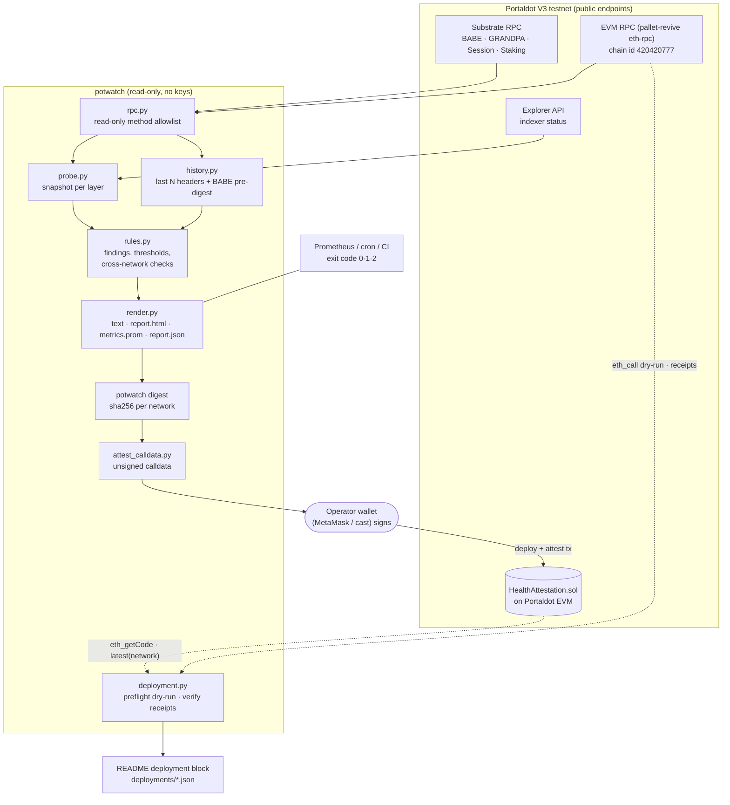

# potwatch architecture

The diagram is also available as [SVG](architecture.svg) and [PNG](architecture.png). Its source is `architecture.mmd`.

## Data flow

1. **Probe** (`probe.py`). The Substrate RPC is read through one batched call: chain name, health (peers), sync state, runtime version, best and finalized heads, and the best header. Storage reads use `state_getStorage` with precomputed `twox128` keys (`keys.py`): `Timestamp.Now`, `Session.Validators`, `Session.CurrentIndex`, `Babe.Authorities`, `Grandpa.CurrentSetId`, `Staking.ActiveEra` and `Staking.ValidatorCount`. GRANDPA authorities come from `state_call GrandpaApi_grandpa_authorities`, and the live round comes from `grandpa_roundState`. The EVM RPC and the explorer API are probed separately, so each layer fails independently.
2. **History** (`history.py`). It fetches the last N block hashes and headers in batches of 50, reads `Timestamp.Now` at each block, and decodes the BABE pre-runtime digest (`babe.py`: engine `BABE`, slot kind, authority index, slot). From these it computes block-time mean, median, p95 and max, slot fill rate, missed slots, per-author share and the longest gap.
3. **Rules** (`rules.py`). These are pure functions from a snapshot and history to a list of `Finding(code, severity, message, hint)`. `compare_networks` runs across all snapshots to find keys shared between networks. Nothing in this module does I/O, so the tests run on captured JSON.
4. **Render** (`render.py`). Outputs are a terminal summary, Prometheus textfile metrics, and one self-contained HTML page with inline SVG block-time charts (no JS and no CDN).
5. **Attest**. `potwatch digest` hashes each network's result as canonical JSON (sorted keys, no whitespace) with sha256. `scripts/attest_calldata.py` builds unsigned calldata for `HealthAttestation.attest`, and the operator's own wallet signs and sends it. potwatch itself never holds a key.
6. **Deploy check** (`scripts/deployment.py`). `preflight` dry-runs the constructor with `eth_call` and compares the returned runtime code with the build. `verify` reads the deploy and attest receipts back, checks code, owner and `latest(network)`, and records the address, hashes and explorer links.

## Safety

- `Rpc` refuses any method that is not on `READ_ONLY_METHODS`. `state_call` is further limited to read-only GRANDPA runtime APIs. potwatch cannot submit extrinsics, author keys, or rotate anything.
- No key material is read or stored. Signing happens outside the tool.

## GRANDPA fault tolerance

GRANDPA finalizes when more than 2/3 of voter weight precommits. With `n` equal-weight voters, the number that can be offline while finality continues is `floor((n-1)/3)`:

| validators | tolerated offline |
|---|---|
| 1-3 | 0 |
| 4-6 | 1 |
| 7-9 | 2 |

Both Portaldot V3 networks observed on 2026-10-28 run 2 validators, so one offline voter halts finality. With 2 BABE authorities, one offline authority halves block production. Secondary slots still fill, but at half rate.

## Extending

- New check: add a branch in `evaluate()` and a test with a modified fixture.
- New network: add an entry in `networks.json`.
- Alerting: run `potwatch check` from cron; exit code 2 means critical. Or scrape `metrics.prom`.
